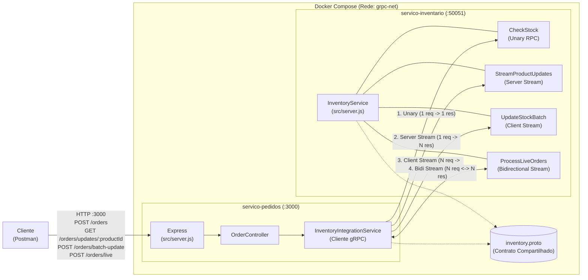

# lab-grpc — Comunicação entre Microsserviços com gRPC, Docker e Docker Compose

Atividade prática de comunicação entre microsserviços utilizando **Node.js**, **gRPC** e **Protocol Buffers (Protobuf)**, cobrindo os **4 padrões oficiais de comunicação gRPC** (*Unary*, *Server Streaming*, *Client Streaming* e *Bidirectional Streaming*), com containerização individual via **Dockerfile** e orquestração com **Docker Compose**.

## 🏗️ Arquitetura



### Fluxo das Chamadas por Camada

1. **Entrada HTTP (`Cliente` ➔ `servico-pedidos`):**
   * O **Postman** envia requisições REST/JSON para o **Express (`src/server.js`)** na porta `3000`.
   * O **OrderController** recebe e valida a requisição, mantendo-se totalmente isolado do protocolo gRPC.
2. **Integração gRPC (`InventoryIntegrationService` ➔ `servico-inventario`):**
   * O **InventoryIntegrationService** encapsula o cliente gRPC, lê o contrato `inventory.proto` e se conecta ao host `servico-inventario:50051` pela rede interna `grpc-net` do Docker Compose.
   * **Unary (`POST /orders`):** envia 1 mensagem (`CheckStock`) e aguarda 1 resposta via *callback*/*Promise*.
   * **Server Streaming (`GET /orders/updates/:productId`):** envia 1 requisição (`StreamProductUpdates`) e escuta múltiplas respostas contínuas em `call.on('data')` até `call.on('end')`.
   * **Client Streaming (`POST /orders/batch-update`):** lê `lote-produtos.json`, envia 1.000 mensagens via `call.write()` (`UpdateStockBatch`), encerra com `call.end()` e recebe 1 resumo consolidado.
   * **Bidirectional Streaming (`POST /orders/live`):** envia cada pedido via `call.write()` (`ProcessLiveOrders`) enquanto escuta respostas individuais em tempo real em `call.on('data')` até ambos os lados chamarem `call.end()`.

## 📁 Estrutura do Código Base

```text
lab-grpc/
├── inventory.proto
├── servico-inventario/
│   └── src/
│       └── server.js
└── servico-pedidos/
    ├── scripts/
    │   └── generate-batch.js
    └── src/
        ├── interfaces/
        │   └── controllers/
        │       └── OrderController.js
        └── services/
            └── InventoryIntegrationService.js
```

## 🚀 Roteiro de Implementação e Execução

### Passo 1: Reconhecimento e Configuração Inicial

1. Faça o clone do repositório base:

   ```bash
   git clone https://github.com/Engenharia-de-App-Web-Backend/lab-grpc.git
   cd lab-grpc
   ```

2. Inicialize o `npm` em ambos os diretórios e instale as dependências:

   * **Em `servico-inventario`:**

     ```bash
     cd servico-inventario
     npm init -y
     npm install @grpc/grpc-js @grpc/proto-loader
     ```

   * **Em `servico-pedidos`:**

     ```bash
     cd servico-pedidos
     npm init -y
     npm install express @grpc/grpc-js @grpc/proto-loader
     ```

3. Analise o `OrderController.js` e observe que toda a complexidade de rede/gRPC está encapsulada no `InventoryIntegrationService.js`.

### Passo 2: Construindo a Porta de Entrada REST (Serviço de Pedidos)

1. Crie o arquivo `servico-pedidos/src/server.js`.
2. Configure um servidor **Express** com `express.json()`.
3. Importe e instancie o `OrderController`.
4. Crie a rota `POST /orders` apontando para o método `createOrder` do *controller*.

### Passo 3: Execução e Validação do Fluxo Unário (`CheckStock`)

1. **Terminal 1 (Inventário — porta `50051`):**

   ```bash
   cd servico-inventario
   node src/server.js
   ```

2. **Terminal 2 (Pedidos — porta `3000`):**

   ```bash
   cd servico-pedidos
   node src/server.js
   ```

3. **Validação no Postman:** `POST http://localhost:3000/orders`

   ```json
   {
     "productId": "123",
     "amount": 2
   }
   ```

### Passo 4: Acompanhamento de Atualizações com Server Streaming (`StreamProductUpdates`)

O contrato `inventory.proto` já declara o método de *Server Streaming* (`1 requisição ➔ N respostas`):

```protobuf
rpc StreamProductUpdates (StreamRequest) returns (stream ProductUpdate);
```

1. **Servidor (`servico-inventario/src/server.js`):** Verifique se o *handler* de `StreamProductUpdates` está implementado. Caso contrário, envie múltiplas atualizações usando `call.write(...)` e encerre o fluxo com `call.end()`.
2. **Cliente (`InventoryIntegrationService.js`):** Crie o método `streamProductUpdates(productId)` retornando uma `Promise`:
   * Inicie a chamada com `const call = this.client.StreamProductUpdates({ product_id: productId });`.
   * Acumule cada atualização recebida em `call.on('data', ...)`.
   * Resolva a `Promise` em `call.on('end', ...)` e rejeite em `call.on('error', ...)`.
3. **Rota REST (`OrderController.js` e `server.js`):** Crie o método no *controller* recebendo `req.params.productId` e exponha a rota `GET /orders/updates/:productId`.
4. **Validação no Postman:** `GET http://localhost:3000/orders/updates/123`.

### Passo 5: Atualização em Lote com Client Streaming (`UpdateStockBatch`)

1. **Preparação dos dados (Mock):** Dentro de `servico-pedidos`, execute:

   ```bash
   node scripts/generate-batch.js
   ```

   Será gerado o arquivo `lote-produtos.json` com 1.000 registros (`product_id`, `status` e `quantity_added`).

2. **Contrato (`inventory.proto`):** Crie as mensagens adequadas e adicione o método `UpdateStockBatch` usando `stream` **apenas na requisição**, retornando um resumo único.
3. **Servidor (`servico-inventario/src/server.js`):** Implemente o *handler* escutando `call.on('data', ...)` e retornando o resumo via `callback` em `call.on('end', ...)`.
4. **Cliente (`InventoryIntegrationService.js`):** Leia `lote-produtos.json` com `fs`, abra a *stream*, envie cada item via `call.write(produto)`, finalize com `call.end()` e resolva a `Promise` com o resultado.
5. **Rota REST:** Crie o método no `OrderController.js` e exponha `POST /orders/batch-update` no `server.js`.

### Passo 6: Processamento em Tempo Real com Stream Bidirecional (`ProcessLiveOrders`)

1. **Contrato (`inventory.proto`):** Adicione `ProcessLiveOrders` no `InventoryService` com `stream` na entrada e no retorno:
   * **Request:** `order_id` (`string`), `product_id` (`string`), `amount` (`int32`).
   * **Response:** `order_id` (`string`), `status` (`string`), `message` (`string`).
2. **Servidor (`servico-inventario/src/server.js`):** Em `call.on('data', ...)`, simule o processamento (ex: 70% aprovado / 30% rejeitado) e responda imediatamente com `call.write(...)`. Ao receber `call.on('end', ...)`, encerre com `call.end()`.
3. **Cliente (`InventoryIntegrationService.js`):** Abra a *stream* bidirecional, armazene as respostas em `call.on('data', ...)`, resolva a `Promise` em `call.on('end', ...)`, envie os pedidos com `call.write(pedido)` e finalize com `call.end()`.
4. **Rota REST (`OrderController.js` e `server.js`):**
   * Valide `req.body.orders` com `Array.isArray()`.
   * Garanta o escopo do `this` no *controller* usando **Arrow Functions** ou `.bind(this)`.
   * Exponha a rota `POST /orders/live`.
5. **Validação no Postman:** `POST http://localhost:3000/orders/live`

   ```json
   {
     "orders": [
       { "order_id": "ORD-01", "product_id": "123", "amount": 2 },
       { "order_id": "ORD-02", "product_id": "456", "amount": 5 },
       { "order_id": "ORD-03", "product_id": "789", "amount": 1 }
     ]
   }
   ```

### Passo 7: Containerização e Orquestração (Dockerfile + Docker Compose)

1. **Ajuste de rede nos serviços:**
   * Em `InventoryIntegrationService.js`, configure o endereço via variável de ambiente:

     ```js
     const INVENTORY_URL = process.env.INVENTORY_SERVICE_URL || 'localhost:50051';
     ```

   * Em `servico-inventario/src/server.js`, garanta o *bind* em `0.0.0.0:50051`.

2. **Dockerfiles individuais:**
   * Crie `servico-inventario/Dockerfile` (base `node:20-alpine`, `EXPOSE 50051`, copiando código + `inventory.proto`).
   * Crie `servico-pedidos/Dockerfile` (base `node:20-alpine`, `EXPOSE 3000`, copiando código + `lote-produtos.json` + `inventory.proto`).
   * Crie `.dockerignore` ignorando `node_modules` e `.git`.

3. **Orquestração (`docker-compose.yml` na raiz):**

   ```yaml
   services:
     servico-inventario:
       build:
         context: .
         dockerfile: servico-inventario/Dockerfile
       container_name: servico-inventario
       ports:
         - "50051:50051"
       networks:
         - grpc-net

     servico-pedidos:
       build:
         context: .
         dockerfile: servico-pedidos/Dockerfile
       container_name: servico-pedidos
       ports:
         - "3000:3000"
       environment:
         - INVENTORY_SERVICE_URL=servico-inventario:50051
       depends_on:
         - servico-inventario
       networks:
         - grpc-net

   networks:
     grpc-net:
       driver: bridge
   ```

4. **Subindo e validando o ambiente completo:**

   ```bash
   docker compose up --build
   ```

   Teste novamente as quatro rotas no Postman (`POST /orders`, `GET /orders/updates/:productId`, `POST /orders/batch-update` e `POST /orders/live`). Para encerrar o ambiente:

   ```bash
   docker compose down
   ```

## 📊 Resumo dos Padrões Implementados

| Etapa | Rota REST | Método gRPC | Padrão / Recurso | Características |
| ----- | ----- | ----- | ----- | ----- |
| **Passos 2–3** | `POST /orders` | `CheckStock` | **Unary RPC** | 1 requisição ➔ 1 resposta |
| **Passo 4** | `GET /orders/updates/:productId` | `StreamProductUpdates` | **Server Streaming** | 1 requisição ➔ *N* respostas (`call.on('data')`) |
| **Passo 5** | `POST /orders/batch-update` | `UpdateStockBatch` | **Client Streaming** | *N* requisições (`call.write`) ➔ 1 resposta de resumo |
| **Passo 6** | `POST /orders/live` | `ProcessLiveOrders` | **Bidirectional Streaming** | *N* requisições em fluxo ⇄ *N* respostas em tempo real |
| **Passo 7** | Todas as rotas acima | — | **Docker + Compose** | 1 `Dockerfile` por microsserviço + `docker-compose.yml` na raiz |

## 🔗 Links de Referência

* [Protocol Buffers — Overview](https://protobuf.dev/overview/)
* [Testando serviços gRPC no Postman](https://learning.postman.com/docs/use/send-requests/protocols/grpc/grpc-request-interface)
* [Docker — Best practices for writing Dockerfiles](https://docs.docker.com/build/building/best-practices/)
* [Docker Compose — Overview](https://docs.docker.com/compose/)
