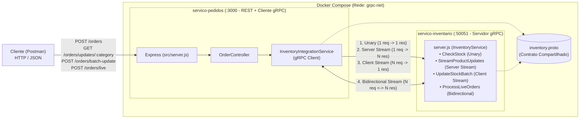

# lab-grpc — Comunicação entre Microsserviços com gRPC

Atividade prática de comunicação entre microsserviços utilizando **Node.js**, **gRPC** e **Protocol Buffers (Protobuf)**, cobrindo os **4 padrões oficiais de comunicação gRPC** (*Unary*, *Server Streaming*, *Client Streaming* e *Bidirectional Streaming*), com containerização individual via **Dockerfile** e orquestração com **Docker Compose**.

* **Serviço de Pedidos (`servico-pedidos`):** Porta de entrada **REST (Express)** e **cliente gRPC**.
* **Serviço de Inventário (`servico-inventario`):** **Servidor gRPC** escutando na porta `50051`.

---

## Arquitetura e Fluxo das Chamadas



### Fluxo das Chamadas por Camada

1. **Entrada HTTP (`Cliente` ➔ `servico-pedidos`):**
   * O **Postman** envia requisições REST/JSON para o **Express (`src/server.js`)** na porta `3000`.
   * O **OrderController** recebe e valida a requisição, mantendo-se totalmente isolado do protocolo gRPC.
2. **Integração gRPC (`InventoryIntegrationService` ➔ `servico-inventario`):**
   * O **InventoryIntegrationService** encapsula o cliente gRPC, lê o contrato `inventory.proto` e se conecta ao host `servico-inventario:50051` pela rede interna `grpc-net` do Docker Compose.
   * **Unary (`POST /orders`):** envia 1 mensagem (`CheckStock`) e aguarda 1 resposta via *callback*/*Promise*.
   * **Server Streaming (`GET /orders/updates/:category`):** envia 1 requisição (`StreamProductUpdates`) com a categoria desejada e escuta múltiplas respostas (`ProductUpdate`) enviadas continuamente pelo servidor em `call.on('data')` até `call.on('end')`.
   * **Client Streaming (`POST /orders/batch-update`):** lê `lote-produtos.json`, envia 1.000 mensagens via `call.write()` (`UpdateStockBatch`), encerra com `call.end()` e recebe 1 resumo consolidado (`BatchUpdateResponse`).
   * **Bidirectional Streaming (`POST /orders/live`):** envia cada pedido via `call.write()` (`ProcessLiveOrders`) enquanto escuta respostas individuais em tempo real em `call.on('data')` até ambos os lados chamarem `call.end()`.

---

## Estrutura do Código Base

* `inventory.proto` — Contrato compartilhado entre os dois serviços.
* `servico-inventario/src/server.js` — Servidor gRPC.
* `servico-pedidos/src/services/InventoryIntegrationService.js` — Camada de serviço responsável pela comunicação gRPC.
* `servico-pedidos/src/interfaces/controllers/OrderController.js` — Controlador HTTP.

---

## Passo 1: Reconhecimento e Configuração Inicial

1. Faça o clone ou download do repositório base:

   ```bash
   git clone https://github.com/Engenharia-de-App-Web-Backend/lab-grpc.git
   ```

2. Inicialize o `npm` em **ambos os diretórios** (`servico-inventario` e `servico-pedidos`) e instale as dependências:

   * **Em `servico-inventario`:**

     ```bash
     npm init -y
     npm install @grpc/grpc-js @grpc/proto-loader
     ```

   * **Em `servico-pedidos`:**

     ```bash
     npm init -y
     npm install express @grpc/grpc-js @grpc/proto-loader
     ```

3. Analise o código do `OrderController.js`. Observe que ele não possui nenhuma referência ao protocolo gRPC — toda a complexidade de rede está encapsulada no `InventoryIntegrationService.js`.

## Passo 2: Construindo a Porta de Entrada REST (Serviço de Pedidos)

O `servico-pedidos` não possui o arquivo de inicialização do servidor HTTP. Você deverá criá-lo:

1. Crie o arquivo `servico-pedidos/src/server.js`.
2. Configure um servidor **Express** com suporte a JSON (`express.json()`).
3. Importe e instancie o `OrderController`.
4. Crie a rota `POST /orders` apontando para o método `createOrder` do *controller*.

## Passo 3: Execução e Validação do Fluxo Unário (`CheckStock`)

1. **Terminal 1 (Inventário):** Inicie o servidor gRPC (porta `50051`):

   ```bash
   cd servico-inventario
   node src/server.js
   ```

2. **Terminal 2 (Pedidos):** Inicie a API REST (ex: porta `3000`):

   ```bash
   cd servico-pedidos
   node src/server.js
   ```

3. **Validação no Postman:** Envie uma requisição `POST` para `http://localhost:3000/orders` com o corpo:

   ```json
   {
     "productId": "123",
     "amount": 2
   }
   ```

4. **Verificação do fluxo:** A requisição segue o caminho:
   `Postman (HTTP)` ➔ `Express` ➔ `OrderController` ➔ `InventoryIntegrationService` ➔ `gRPC (Serviço de Inventário)` ➔ `Resposta HTTP`.

## Passo 4: Acompanhamento de Atualizações com Server Streaming

Nesta etapa, você implementará o consumo do método **`StreamProductUpdates`**, já declarado no contrato `inventory.proto` (`1 requisição ➔ N respostas em fluxo contínuo`):

```protobuf
// Comunicação Server Streaming (1 request -> N responses)
rpc StreamProductUpdates (StreamRequest) returns (stream ProductUpdate);

message StreamRequest {
  string category = 1;
}

message ProductUpdate {
  string product_id = 1;
  string status = 2;
}
```

### 4.1 Análise do Servidor gRPC (`servico-inventario/src/server.js`)

O *handler* de `StreamProductUpdates` **já está implementado** no código base do Serviço de Inventário. Antes de desenvolver o cliente, analise sua implementação em `servico-inventario/src/server.js` e observe:

1. O método recebe apenas `call` (sem o `callback` tradicional das chamadas unárias).
2. A categoria solicitada é lida a partir de `call.request.category`.
3. O servidor envia múltiplas atualizações (`{ product_id, status }`) de forma contínua usando `call.write(...)`.
4. Ao finalizar o envio de todos os eventos, o servidor encerra o fluxo chamando `call.end()`.

### 4.2 Implementação no Cliente gRPC (`InventoryIntegrationService.js`)

No código base, o `InventoryIntegrationService` implementa apenas o método unário `checkStock(productId)`. Adicione o novo método para consumir a *stream* do servidor:

1. Crie um método `streamProductUpdates(category)` que retorne uma `Promise`.
2. Inicie a chamada gRPC enviando o campo `category` conforme definido em `StreamRequest`:

   ```js
   const call = this.client.StreamProductUpdates({ category });
   ```

3. Crie um array para armazenar as atualizações recebidas e escute os três eventos da *stream*:
   * `call.on('data', (update) => { ... })`: adiciona cada `ProductUpdate` (`{ product_id, status }`) recebido ao array (e opcionalmente exibe no `console.log` para acompanhar em tempo real).
   * `call.on('end', () => { ... })`: resolve a `Promise` devolvendo o array com todas as atualizações recebidas.
   * `call.on('error', (error) => { ... })`: rejeita a `Promise` em caso de falha na comunicação.

### 4.3 Exposição da Rota REST (`OrderController.js` e `server.js`)

1. No `OrderController.js`, crie o método `streamProductUpdates` que extrai a categoria de `req.params.category` (ou `req.query.category`), chama `streamProductUpdates(category)` no `InventoryIntegrationService` e retorna o JSON com o histórico de atualizações recebidas.
2. No `servico-pedidos/src/server.js`, registre a rota `GET /orders/updates/:category` apontando para o novo método do *controller*.

### 4.4 Validação no Postman

1. Reinicie os serviços e envie uma requisição `GET` para `http://localhost:3000/orders/updates/eletronicos`.
2. Acompanhe no terminal do `servico-pedidos` a chegada sequencial de cada evento enviado pelo `servico-inventario` e verifique a lista completa de `{ product_id, status }` retornada no Postman.

## Passo 5: Atualização em Lote com Client Streaming

Nesta etapa, você implementará uma rota para processar um lote de 1.000 atualizações de estoque utilizando **Client Streaming** (várias requisições enviadas em fluxo contínuo para uma única resposta de resumo).

1. **Geração dos dados (Mock):** Dentro de `servico-pedidos`, execute o script gerador:

   ```bash
   node scripts/generate-batch.js
   ```

   Isso criará o arquivo `lote-produtos.json` na raiz do projeto com 1.000 registros contendo `product_id`, `status` e `quantity_added`.

2. **Atualização do contrato (`inventory.proto`):**
   * Defina as mensagens `BatchUpdateRequest` (`product_id`, `status`, `quantity_added`) e `BatchUpdateResponse` (`total_processed` do tipo `int32` e `message` do tipo `string`).
   * Adicione o método `UpdateStockBatch` utilizando a palavra-chave `stream` **apenas no parâmetro de entrada**:
     ```protobuf
     rpc UpdateStockBatch (stream BatchUpdateRequest) returns (BatchUpdateResponse);
     ```

3. **Atualização do servidor (`servico-inventario/src/server.js`):**
   * Implemente o *handler* de `UpdateStockBatch`.
   * Escute o evento `call.on('data', ...)` para processar cada item recebido no fluxo e acumular a contagem.
   * Escute o evento `call.on('end', ...)` para invocar o `callback` retornando `{ total_processed, message }`.

4. **Atualização do cliente (`InventoryIntegrationService.js`):**
   * Crie um método que leia o arquivo `lote-produtos.json` do disco com o módulo nativo `fs`.
   * Abra a *stream* gRPC para o servidor dentro de uma `Promise`.
   * Percorra o array lido (`for` ou `for...of`) enviando cada registro com `call.write(produto)`.
   * Ao final do laço, encerre o envio chamando `call.end()` e resolva a `Promise` com a resposta retornada pelo servidor (`{ total_processed, message }`).

5. **Exposição da rota REST:**
   * Crie o método correspondente no `OrderController.js`.
   * Registre a rota `POST /orders/batch-update` no `servico-pedidos/src/server.js` e valide no Postman.

## Passo 6: Processamento em Tempo Real com Stream Bidirecional

Nesta etapa, cliente e servidor trocarão mensagens simultaneamente na mesma conexão aberta (*Live Processing*).

### 6.1 Atualizando o Contrato (`inventory.proto`)

1. Adicione o método `ProcessLiveOrders` ao `InventoryService`, utilizando `stream` **tanto na entrada quanto no retorno**.
2. Defina as mensagens:
   * **`LiveOrderRequest`:** `order_id` (`string`), `product_id` (`string`), `amount` (`int32`).
   * **`LiveOrderResponse`:** `order_id` (`string`), `status` (`string`), `message` (`string`).

### 6.2 Atualizando o Servidor gRPC (`servico-inventario/src/server.js`)

1. Adicione o *handler* de `ProcessLiveOrders` (sem uso do `callback` tradicional).
2. No evento `call.on('data', ...)`, simule o processamento de cada pedido (ex: 70% de chance de aprovação e 30% de rejeição) e devolva a resposta imediatamente com `call.write(...)`.
3. No evento `call.on('end', ...)`, encerre a conexão do lado do servidor com `call.end()`.

### 6.3 Atualizando o Cliente gRPC (`InventoryIntegrationService.js`)

1. Crie um método que receba um array de pedidos e retorne uma `Promise`.
2. Inicie a *stream* bidirecional e inicialize um array vazio para acumular os resultados.
3. Escute `call.on('data', ...)` para armazenar cada resposta recebida do servidor.
4. Escute `call.on('end', ...)` para resolver a `Promise` com o array de resultados acumulados.
5. Na sequência, itere sobre o array de pedidos (`for...of`), enviando cada item com `call.write(pedido)`.
6. Ao terminar o laço, sinalize o fim do envio com `call.end()`.

### 6.4 Expondo a Rota REST (`OrderController.js` e `server.js`)

1. No `OrderController.js`, crie o método para receber a lista de pedidos em `req.body.orders`.
2. Valide se a entrada é um array utilizando `Array.isArray()`.
3. Chame o método do `InventoryIntegrationService`, aguarde a `Promise` e retorne o resultado em JSON.

   > **Atenção ao escopo do `this`:** Garanta o vínculo correto do `this` no *controller* usando **Arrow Functions** ou `.bind(this)` no construtor.

4. Registre a rota `POST /orders/live` no `servico-pedidos/src/server.js`.

### 6.5 Validação via Postman

1. Reinicie ambos os serviços (`servico-inventario` e `servico-pedidos`).
2. Envie uma requisição `POST` para `http://localhost:3000/orders/live` com um payload de exemplo:

   ```json
   {
     "orders": [
       { "order_id": "ORD-01", "product_id": "123", "amount": 2 },
       { "order_id": "ORD-02", "product_id": "456", "amount": 5 },
       { "order_id": "ORD-03", "product_id": "789", "amount": 1 }
     ]
   }
   ```

3. Verifique se cada pedido retorna individualmente com `order_id`, `status` e `message`.

## Passo 7: Containerização e Orquestração (Dockerfile + Docker Compose)

Cada microsserviço deve ser empacotado de forma independente em seu próprio `Dockerfile` e orquestrado por um `docker-compose.yml` na raiz do projeto.

### 7.1 Preparação para Comunicação em Rede Docker

1. No `servico-pedidos/src/services/InventoryIntegrationService.js`, substitua o endereço fixo `localhost:50051` por uma variável de ambiente com *fallback*:

   ```js
   const INVENTORY_URL = process.env.INVENTORY_SERVICE_URL || 'localhost:50051';
   ```

   > **Por quê?** Dentro de um contêiner, `localhost` aponta para o próprio contêiner. Na rede criada pelo Compose, o `servico-pedidos` alcança o `servico-inventario` usando o nome do serviço como hostname (`servico-inventario:50051`).

2. No `servico-inventario/src/server.js`, certifique-se de que o servidor gRPC faça o *bind* em `0.0.0.0:50051` (e não em `127.0.0.1`), permitindo conexões externas ao contêiner.

### 7.2 Criação dos Dockerfiles Individuais

Crie um `Dockerfile` separado para cada aplicação e um `.dockerignore` (ignorando `node_modules` e `.git`):

1. **`servico-inventario/Dockerfile`:**
   * Utilize uma imagem base leve do Node.js (ex: `node:20-alpine`).
   * Copie `package.json` e `package-lock.json` e execute `npm install`.
   * Copie o código-fonte do serviço e o contrato `inventory.proto` para o caminho esperado pelo `server.js`.
   * Exponha a porta `50051` (`EXPOSE 50051`) e defina `CMD ["node", "src/server.js"]`.

2. **`servico-pedidos/Dockerfile`:**
   * Utilize a mesma imagem base (`node:20-alpine`).
   * Copie `package.json` e `package-lock.json` e execute `npm install`.
   * Copie o código-fonte do serviço, os scripts/dados necessários (como `lote-produtos.json`) e o contrato `inventory.proto` para o caminho esperado pelo `InventoryIntegrationService.js`.
   * Exponha a porta HTTP escolhida (ex: `EXPOSE 3000`) e defina `CMD ["node", "src/server.js"]`.

### 7.3 Orquestração com Docker Compose

Crie o arquivo `docker-compose.yml` na **raiz do repositório** para construir e subir ambos os microsserviços conectados na mesma rede interna.

> **Dica sobre o contexto de build:** Defina `context: .` (raiz do repositório) em ambos os serviços e aponte o caminho específico em `dockerfile:`. Assim, os dois `Dockerfiles` conseguem copiar o arquivo compartilhado `inventory.proto`.

Estrutura esperada para o `docker-compose.yml`:

```yaml
services:
  servico-inventario:
    build:
      context: .
      dockerfile: servico-inventario/Dockerfile
    container_name: servico-inventario
    ports:
      - "50051:50051"
    networks:
      - grpc-net

  servico-pedidos:
    build:
      context: .
      dockerfile: servico-pedidos/Dockerfile
    container_name: servico-pedidos
    ports:
      - "3000:3000"
    environment:
      - INVENTORY_SERVICE_URL=servico-inventario:50051
    depends_on:
      - servico-inventario
    networks:
      - grpc-net

networks:
  grpc-net:
    driver: bridge
```

### 7.4 Execução e Validação do Ambiente Completo

1. Na raiz do projeto, construa as imagens e suba todo o ambiente:

   ```bash
   docker compose up --build
   ```

2. Acompanhe nos logs se o `servico-inventario` iniciou na porta `50051` e o `servico-pedidos` na porta `3000`.
3. **Validação final no Postman:** Execute novamente as quatro rotas (`POST /orders`, `GET /orders/updates/:category`, `POST /orders/batch-update` e `POST /orders/live`) apontando para `http://localhost:3000` e confirme que toda a comunicação gRPC ocorre entre os contêineres.
4. Ao finalizar os testes, encerre e remova os contêineres com:

   ```bash
   docker compose down
   ```

## Resumo dos Padrões Implementados

| Etapa | Rota REST | Método gRPC | Padrão / Recurso | Características |
| ----- | ----- | ----- | ----- | ----- |
| **Passos 2–3** | `POST /orders` | `CheckStock` | **Unary RPC** | 1 requisição (`product_id`) ➔ 1 resposta (`available`, `quantity`) |
| **Passo 4** | `GET /orders/updates/:category` | `StreamProductUpdates` | **Server Streaming** | 1 requisição (`category`) ➔ *N* respostas (`product_id`, `status`) |
| **Passo 5** | `POST /orders/batch-update` | `UpdateStockBatch` | **Client Streaming** | *N* requisições (`call.write`) ➔ 1 resumo (`total_processed`, `message`) |
| **Passo 6** | `POST /orders/live` | `ProcessLiveOrders` | **Bidirectional Streaming** | *N* requisições em fluxo ⇄ *N* respostas em tempo real |
| **Passo 7** | Todas as rotas acima | — | **Docker + Compose** | 1 `Dockerfile` por microsserviço + `docker-compose.yml` na raiz |

## Links de Referência

* [Protocol Buffers — Overview](https://protobuf.dev/overview/)
* [Testando serviços gRPC no Postman](https://learning.postman.com/docs/use/send-requests/protocols/grpc/grpc-request-interface)
* [Docker — Best practices for writing Dockerfiles](https://docs.docker.com/build/building/best-practices/)
* [Docker Compose — Overview](https://docs.docker.com/compose/)
